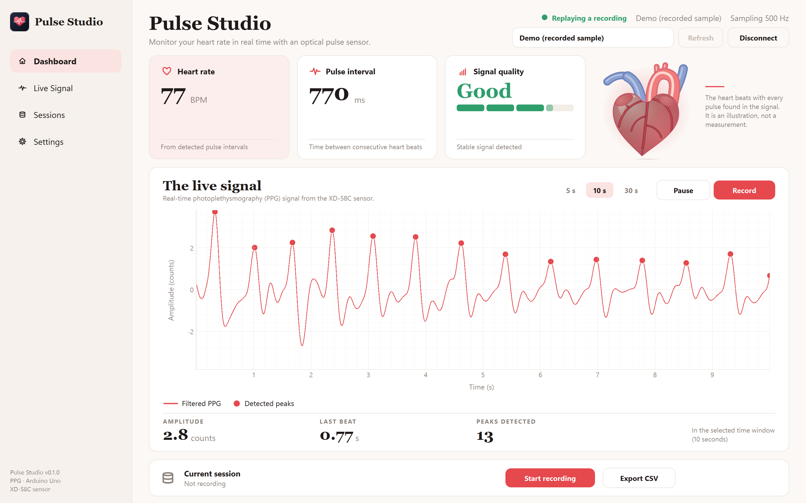

# Pulse Studio

A Windows desktop app that shows the signal from an XD-58C pulse sensor connected to an Arduino Uno in real time: heart rate, interval between beats, signal quality, the live PPG waveform with detected peaks, and heart rate variability.



Status: first release candidate.

## Disclaimer

PPG measures changes in blood volume optically. It does not measure the electrical activity of the heart, and the heart animation in the app is only an illustration. Respiration is an estimate taken from the beat to beat variation. This project is not a medical device and must not be used for diagnosis.

## What it does

- Live PPG trace with detected peaks, in a 5, 10 or 30 s window. Two trace styles: scroll, and sweep (written across the screen like a patient monitor).
- Heart rate (moving average of the last beats), beat to beat interval, signal amplitude and a signal quality indicator with plain advice ("Place a fingertip on the sensor", "Hold still", "Ease the pressure").
- An anatomical heart that contracts exactly when each peak appears on the plot, followed by a slightly delayed swell of the great arteries.
- Tachogram, Poincare plot and a BPM trend. SDNN, RMSSD, pNN50, SD1 and SD2 once there are enough steady beats, and an estimate of the breathing rate.
- It shows nothing rather than a guess: with no finger, movement, a saturated sensor or scattered beats the BPM stays empty and the status says why.
- One-click CSV recording (raw samples and beats), a list of past sessions that can be replayed in the app, and export of the last minute.
- Two looks: Studio (light, warm) and Monitor (dark, glowing trace). The last port and the look are remembered.
- Demo modes for trying it without hardware: a simulated signal with selectable problems, and a recorded sample.

## Wiring

| Sensor | Arduino Uno |
|--------|-------------|
| S      | A0          |
| +      | 5V          |
| -      | GND         |

## Firmware

1. Open `firmware/pulse_sensor/pulse_sensor.ino` in the Arduino IDE.
2. Select the board Arduino Uno and its port, then upload.
3. Close the Serial Monitor and the Serial Plotter before opening the app. A COM port can have only one owner.

The firmware samples A0 at a fixed 500 Hz (timed with `micros()`, no `delay()` in the loop) and sends lines such as `123456,8200` at 115200 baud: the time in microseconds and the sum of 16 ADC readings (oversampling gives about two extra bits, which matters because the pulse is only a few counts wide on this sensor). A line ending in `,1` marks a beat found by the simple detector on the board, which also blinks the LED on pin 13, so the sensor can be checked without a computer.

To look at the signal in the Arduino Serial Plotter instead, open the Serial Monitor at 115200, send `P`, close it and open the Plotter. Send `C` (or just connect the app, which does it for you) to go back to the compact format.

## Running it

Installer: download `PulseStudio-Setup-<version>.exe` from the Releases page. It asks where to install (any drive), adds Start menu and desktop shortcuts, and uninstalls cleanly. Recordings in `Documents\Pulse Studio` are left alone on uninstall.

From source, with Python 3.11 or newer:

```
python -m venv .venv
.venv\Scripts\python -m pip install -e .[dev]
.venv\Scripts\python -m pulse_studio
```

Tests: `.venv\Scripts\python -m pytest`. To build the executable and the installer: `.\scripts\build.ps1` (needs PyInstaller and Inno Setup).

## Processing method

All of it happens in Python, on the 500 Hz stream.

1. Band-pass filter, Butterworth order 2, 0.6 to 3.5 Hz, applied causally with state kept between chunks. The band was chosen on real recordings: a wider top edge let through sub-peaks that produced extra, shorter intervals.
2. Peak detection on the filtered signal: a sample is a peak if it is the maximum within 120 ms on both sides and tall enough compared with the recent signal. Confirmation takes a fixed 120 ms, so the interface shows the trace with a short delay and the marker and the heart fire when the trace reaches the peak.
3. Beat validation: peaks closer than the refractory period (the larger of 300 ms and half the recent median interval) are dropped, intervals outside 300-2000 ms break the chain, and intervals more than 30 percent from the recent median are kept as beats but flagged and excluded from BPM and HRV.
4. BPM is 60000 divided by the mean of the last six valid intervals, and is shown only when those intervals agree (standard deviation under 20 percent of the mean). If single beats are noisy but the rhythm is clear, an estimate from the spectrum is shown with a "~" and the status "Estimating".
5. HRV (SDNN, RMSSD, pNN50, Poincare SD1 and SD2) is computed over the last 90 s of valid intervals after removing those that stray from the local median, and only with at least 20 intervals. RMSSD never uses a difference that spans a rejected beat.
6. Signal quality combines the peak to peak amplitude of the filtered signal, how periodic it is (autocorrelation) and the share of valid beats. It also recognises a saturated sensor (readings stuck at the rails), a movement burst, and a missing finger.

## Getting a good signal

The XD-58C gives a small signal on some setups, a few counts out of 1023. Cover the sensor completely with a fingertip, press lightly and evenly (too much pressure squeezes out the blood and flattens the pulse), keep the finger and the cable still, and avoid bright light leaking in around the finger. A rubber band or a small strap helps.

## Screenshots

Dashboard in the Studio look, and the live view in the Monitor look. More in `docs/screenshots`.

## Project layout

```
firmware/pulse_sensor/   Arduino sketch
src/pulse_studio/dsp/    filter, peaks, beats, HRV, quality, extras
src/pulse_studio/acquisition/   serial reader, port detection, simulator, replay
src/pulse_studio/recording/     CSV recording and session list
src/pulse_studio/ui/     window, pages, plots, heart, theme, icons
installer/               Inno Setup script
docs/sample/             a short recorded sample used by the demo mode
```

## License

MIT, see [LICENSE](LICENSE).
